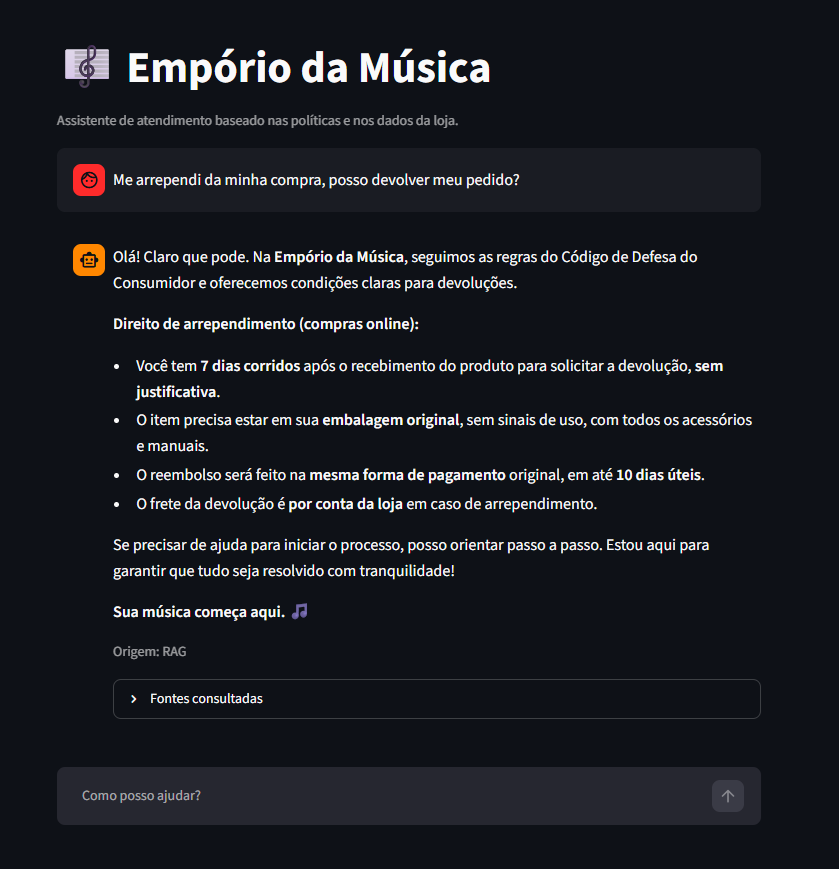

# Customer Support Assistant — Empório da Música

A Portuguese-language customer support application that combines store policies,
catalog data, and operational information to answer questions about instruments,
orders, and customer service policies. The system uses a local model through Ollama
and provides a conversational interface with Streamlit.

The agent determines whether to consult store policies, operational data, or both. It
maintains context for follow-up questions during a session and identifies the sources
used. Out-of-scope questions receive an appropriate response without retrieving
documents or querying the database.

## Architecture

1. **Structured data:** CSV files in `Desafio Técnico AI Engineer 2026/data` are
   automatically loaded into SQLite. Pandas infers column types, and a fingerprint
   detects file changes to avoid rebuilding the database unnecessarily.
2. **Documents:** `PyPDFLoader` extracts PDF pages. `RecursiveCharacterTextSplitter`
   splits the content while preserving source and page metadata.
3. **Retrieval:** BM25 and BGE-M3 retrieve documents in parallel. `EnsembleRetriever`
   combines their rankings using Reciprocal Rank Fusion, and `CrossEncoderReranker`
   with BGE-Reranker-v2-M3 selects the most relevant passage (`k = 1`) for the final
   context. The semantic index is persisted locally.
4. **Routing:** a structured LLM call classifies each question as RAG, SQL, or HYBRID,
   and rewrites references in follow-up questions. Out-of-scope topics receive a
   short response without querying the data sources.
5. **SQL queries:** `SQLDatabase` provides the schema to the LLM and executes the
   generated query. Validation accepts only a single statement starting with `SELECT`
   or `WITH`; the SQLite connection is also opened in read-only mode.
6. **History and response:** a deterministic, single-node workflow with `InMemorySaver`
   keeps conversation history in memory for the duration of the session. The response
   receives only the retrieved passage and/or SQL result, and should state when the
   sources do not contain the necessary information.
7. **Interface:** Streamlit displays the response source, the pages consulted, and the
   generated query for SQL questions.

Routing uses a deterministic chain rather than an autonomous agent. Ollama runs
`qwen3:8b`; embeddings and reranking use the BGE models specified in the configuration.
The BGE-M3 vectors included in `artifacts/` are reused only when the PDF hash, pages,
model, and dimensions match. LangChain's `InMemoryVectorStore` manages the vector
index, which is serialized as JSON. The index and SQLite database are stored in
`.artifacts/` and do not need to be committed to version control.

## Technologies

- Python 3.10+
- LangChain and LangGraph: `ChatOllama`, structured output, loaders, splitters,
  retrievers, compression/reranking, SQLDatabase, and message history
- Ollama: `qwen3:8b`
- BGE-M3 and BGE-Reranker-v2-M3
- SQLite, SQLAlchemy, and Pandas
- InMemoryVectorStore and Streamlit

## Installation

In PowerShell, from the repository root:

```powershell
py -3.11 -m venv .venv
.\.venv\Scripts\Activate.ps1
python -m pip install --upgrade pip
python -m pip install -r requirements.txt -e ".[test]"
```

If the PowerShell execution policy prevents activating the virtual environment, use
the interpreter directly:

```powershell
.\.venv\Scripts\python.exe -m pip install -r requirements.txt -e ".[test]"
```

## Ollama setup

Install and start Ollama. Pull the main model once:

```powershell
ollama pull qwen3:8b
```

The service must be accessible at `http://127.0.0.1:11434`. On the first run, the BGE
models are loaded from Hugging Face; an internet connection is required to download
the model weights if they are not already cached locally. `.env.example` lists
optional variables for configuring the Ollama URL, directories, and model identifiers.
Ollama automatically decides how to distribute Qwen across the GPU and CPU; the BGE
models use the CPU. Qwen remains loaded during consecutive classification and response
calls; before BGE retrieval, the pipeline unloads it to reduce simultaneous memory
usage.

## Run

With the virtual environment activated:

```powershell
streamlit run app.py
```

Streamlit will display the local interface URL. On first startup, the project creates
the SQLite database and local semantic index if needed. Source files remain unchanged.

To validate the installation:

```powershell
pytest
```

The tests cover routing, SQL and HYBRID flows, conversation history, CSV imports,
read-only query validation, and document metadata. The test suite was run in this
environment with **26 tests passing**.

## Sample questions

The application currently handles questions in Brazilian Portuguese. Examples:

- **RAG:** “What is the return period for an online purchase?” (*Qual é o prazo para arrependimento de uma compra online?*)
- **SQL:** “Which products are listed, and what is each item's stock?” (*Quais produtos estão cadastrados e qual é o estoque de cada um?*)
- **HYBRID:** “Can I exchange the item in my order, and are replacements in stock?” (*Posso trocar o produto do meu pedido e há unidades disponíveis?*)

## Technical decisions

Before development, I researched recent approaches to RAG architectures. ChatGPT's
“Deep Research” feature was used as a starting point for finding scientific papers;
I then read the selected papers and used that research to guide the design. My
previous experience with RAG during graduate school also influenced the decisions
and helped me evaluate retrieval alternatives.

I chose RAG because many questions in the challenge depend on information described in
the store policies, rather than only on tabular data. Retrieving passages related to
the question makes it possible to answer based on the provided document without
sending the entire PDF to the model for every interaction. Prices, stock, and other
operational information are queried from the CSVs using SQL. This lets each question
use the most appropriate source, while questions that combine policies and data can
follow the HYBRID flow.

Since the development period was only two days, I prioritized an architecture that
could be implemented and tested within that timeframe, without fine-tuning models.
For document retrieval, I considered alternatives such as MPNet and ColBERT. MPNet
typically benefits from fine-tuning for this type of task, which did not fit the
schedule; ColBERT is an interesting approach but would add installation and
configuration complexity. I chose to combine BM25 and BGE-M3: lexical search helps
find specific terms and names, while semantic search considers the meaning of the
question. Reciprocal Rank Fusion (RRF) combines these two perspectives, and
BGE-Reranker-v2-M3 reranks the candidates to select the most relevant passage.

The PDF is split into pages and then into smaller passages, preserving source and
page metadata. Although the challenge provides a single document, this organization
also prepares retrieval for additional PDFs. After reranking, I use only one passage
(`k = 1`) as the final context. During testing, providing multiple passages to the
local model increased hallucinations and sometimes made it harder to generate an
appropriate response. With a more capable model and a larger context window, this
choice could be revisited, and neighboring pages could be included when needed to
preserve context.

Prompts were iteratively refined during testing to provide clear instructions without
unnecessarily consuming context. The store policy manual served as a reference for
defining the response persona and tone, keeping the customer support experience
consistent with the information provided in the challenge.

Routing was implemented as a deterministic chain rather than an autonomous agent. A
structured call classifies each question as RAG, SQL, or HYBRID before execution.
This makes the data source selection explicit and makes it easier to inspect the path
taken by the application. Questions outside the store's scope are handled without
querying documents or the database.

I chose `qwen3:8b`, running locally through Ollama, as the language model. This avoids
API costs during execution and is sufficient for the prototype, although it is limited
by the model's capabilities and the resources available on the machine. The model is
used for both classification and response generation. Prompts are kept concise to
balance the customer-service instructions, retrieved context, and available context
window. Responses should also follow the store persona and state when the sources do
not contain the necessary information.

For tabular data, I chose SQLite because it is easy to distribute and does not require
a separate database server. CSVs are loaded automatically, and Pandas infers column
types to support queries involving numeric values such as prices and stock. Generated
queries are limited to a single `SELECT` or `WITH` statement, and the connection is
opened in read-only mode.

In the current project structure, LangChain provides integrations for models,
documents, retrieval, and SQL, while LangGraph organizes the workflow and conversation
history. Streamlit provides a simple demonstration interface without distracting
from the agent's functionality. Conversation history is kept in memory for the
duration of a session, avoiding persistence infrastructure that was not essential to
the challenge scope.

## Sample interactions

The images below show five different use cases:

**Applying a return policy (RAG):**



1. **Catalog query with a price filter (SQL):** [part 1](resultados_imagens/pergunta1_parte1.png) and [part 2](resultados_imagens/pergunta1_parte2.png).
2. **Store address information (RAG):** [view image](resultados_imagens/pergunta2.png).
3. **Product price lookup (SQL):** [view image](resultados_imagens/pergunta3.png).
4. **Return policy question (RAG):** [view image](resultados_imagens/pergunta4.png).
5. **Percussion instrument catalog query (SQL):** [view image](resultados_imagens/pergunta5.png).

## Project structure

```text
app.py
src/artefact_rag/
  database.py       # CSV import, SQLite, and read-only queries
  documents.py      # PDF loading and document splitting
  pipeline.py       # Routing and flow execution
  retrieval.py      # BM25, BGE-M3, RRF, reranking, and persistence
  routing.py        # Structured classification
  settings.py       # Centralized configuration
  sql_generation.py # SQL query output schema
artifacts/          # Page embeddings and compatibility metadata
Desafio Técnico AI Engineer 2026/data/     # Provided PDFs and CSVs
tests/
```

## Known limitations and future improvements

- PDF extraction is text-based; there is no OCR or specialized handling of tables or
  images. Future work could better preserve table structure and add OCR for scanned
  documents.
- Classification and SQL generation depend on the quality of the local model.
  Connection and validation restrict SQL operations, but cannot guarantee that every
  question will be classified or interpreted correctly. An evaluation set of
  representative questions would help measure and improve routing, queries, and
  responses.
- Conversation history is kept in memory and is not preserved after the session ends.
  A possible enhancement is per-user persistence, with privacy controls and options
  to delete conversations.
- Retrieval and BGE models can consume significant resources on the first run.
  Optimizations or smaller model options could make the application easier to run on
  machines with less memory.

## Use of coding assistants

During development, I used VS Code with the free version of GitHub Copilot, which
included 200 available credits, as an aid to the development process. The technical
decisions and validation of the application's behavior remain my responsibility.
